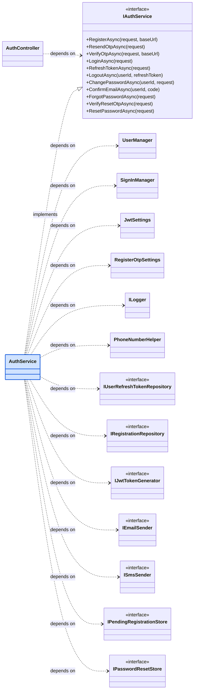
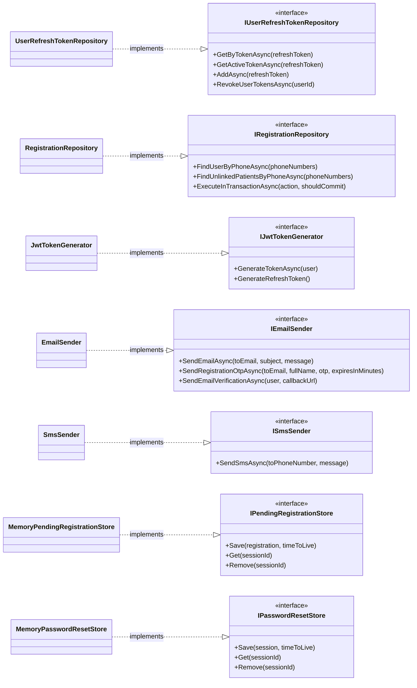

# Class diagram: AuthService (Mermaid)

Vẽ theo mẫu "AuthService ở giữa, các thành phần phụ thuộc xung quanh", lấy từ code thật trong `OZE.Application/Services/AuthService.cs` (constructor có 12 tham số).

- Mũi tên nét đứt, nhãn **depends on**: AuthService dùng thành phần đó (inject qua constructor).
- Mũi tên nét đứt đầu rỗng, nhãn **implements**: lớp cài đặt interface.
- Ô xanh là lớp trọng tâm.

Mermaid tự xếp bố cục nên không tỏa tròn như hình mẫu. Vì vậy tôi tách làm 2 sơ đồ để mỗi hình đủ gọn và dễ đọc.

## Sơ đồ 1: AuthService phụ thuộc vào những gì



## Sơ đồ 2: Lớp nào cài đặt interface nào



## Config cho mermaid.live (tab Config)

Công cụ có sẵn tab **Config** (mặc định là `{"theme": "redux-color"}`, theme này tô màu và vẽ kiểu tay nên hình trông lạ). Xóa nội dung cũ trong tab Config và dán đoạn này vào:

```json
{
  "theme": "default",
  "look": "classic"
}
```

Muốn giữ màu như theme hiện tại nhưng vẫn nét thẳng, chỉ đổi dòng đầu thành `"theme": "redux-color"` và giữ `"look": "classic"`.

Dòng `%%{init: ...}%%` ở đầu mỗi sơ đồ làm cùng việc này, dùng cho nơi không có tab Config (VS Code, GitHub). Dùng một trong hai là đủ, nếu dùng cả hai thì dòng trong code được ưu tiên.

## Cách xem và xuất ảnh

**Cách 1: VS Code (xem ngay trong editor)**
1. Cài tiện ích **Markdown Preview Mermaid Support** (tác giả Matt Bierner).
2. Mở file này, bấm `Ctrl+Shift+V`, hai sơ đồ hiện ngay trong bản xem trước.

**Cách 2: trang web (không cần cài gì)**
1. Vào https://mermaid.live
2. Dán phần code nằm giữa hai dòng ` ```mermaid ` và ` ``` ` của **một** sơ đồ vào ô bên trái.
3. Bấm **Actions** rồi chọn **PNG** hoặc **SVG** để tải ảnh dán vào báo cáo.

**Cách 3: GitHub** tự vẽ sơ đồ Mermaid khi bạn mở file `.md` này trên github.com.

## Ghi chú về sơ đồ

- Khác hình mẫu: hệ thống của bạn **không có `IRepository` chung**, mỗi repository có interface riêng nên không có mũi tên "implements IRepository".
- `UserManager` và `SignInManager` là lớp của ASP.NET Identity (kiểu `<ApplicationUser>`). `JwtSettings` và `RegisterOtpSettings` được inject qua `IOptions`. `PhoneNumberHelper` là lớp tĩnh dùng để chuẩn hóa số điện thoại, nên vẽ là phụ thuộc trực tiếp.
- Muốn xếp tay từng ô giống hệt hình mẫu thì vẽ bằng draw.io (bạn đang dùng file `Achitech System.drawio`). Mermaid chỉ cho phép đổi hướng chung (`direction TB` hoặc `LR`).
