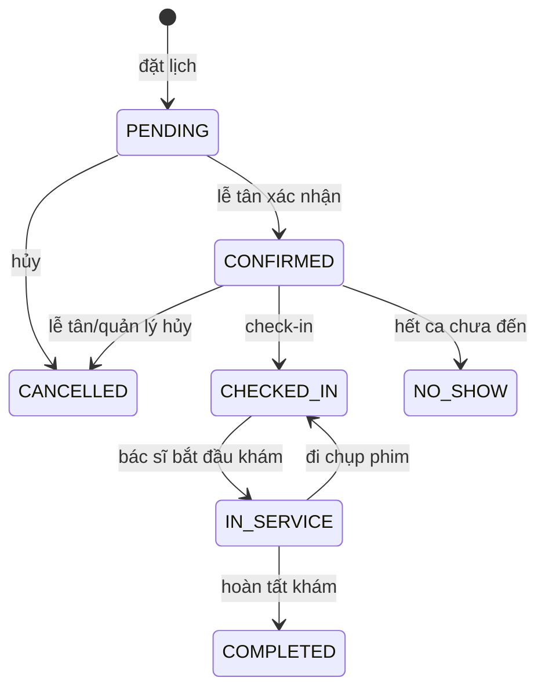
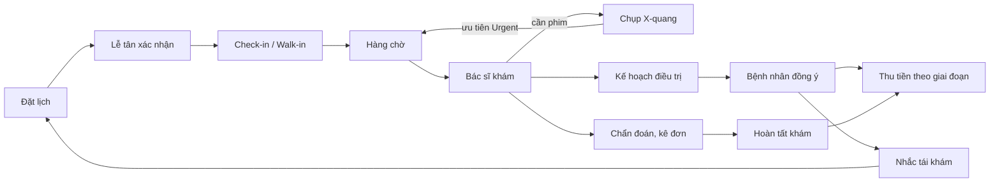

# Đặc tả nghiệp vụ OZE Dental Clinic

Tài liệu chung của nhóm SEP490_G66 để **thống nhất nghiệp vụ từng chức năng** trước khi làm BE, FE và test. Cập nhật 10/11/2026, đối chiếu code hiện tại trong `oze-clinic-be`, biên bản họp với phòng khám và hai tài liệu `Tong_quan_he_thong_OZE.md`, `Tong_hop_chuc_nang_da_lam_chua_lam.md`.

## 0. Cách dùng tài liệu này

1. **Tài liệu là "hợp đồng" giữa BE, FE và người làm test.** Ai làm chức năng nào thì đọc mục của chức năng đó trước khi code.
2. **Sửa nghiệp vụ thì sửa tài liệu trước**, ghi một dòng vào mục 9 (Nhật ký thay đổi), báo nhóm, rồi mới sửa code.
3. **Mỗi quy tắc có mã `BR-...`.** Commit, Jira task, unit test và câu hỏi review ghi kèm mã này để biết đang làm theo quy tắc nào.
4. **Câu hỏi chưa chốt** nằm ở mục 8. Chưa chốt thì làm theo "Mặc định tạm" ghi ở đó, không tự đoán thêm.
5. Cột **Trạng thái**: ✅ đã có API, 🟡 làm một phần, ⬜ chưa làm.

Mỗi chức năng được mô tả theo cùng một khung: **Mã · Vai trò · Tiền điều kiện · Luồng chính · Quy tắc (BR) · Trạng thái đổi · API · Trạng thái làm**.

**Chi tiết từng chức năng** (API, luồng trong code kèm `File.cs:dòng`, lỗi, test): [chuc-nang/README.md](chuc-nang/README.md). Tài liệu này giữ phần nghiệp vụ tổng; khi hai bên lệch nhau, file chức năng mô tả code đang chạy, tài liệu này mô tả nghiệp vụ mong muốn.

---

## 1. Vai trò và quyền

| Vai trò | Mã role | Phạm vi dữ liệu |
|---|---|---|
| Bệnh nhân | `Patient` | Chỉ dữ liệu của chính mình. Truy cập dữ liệu người khác trả **404** (không lộ là có tồn tại) |
| Lễ tân kiêm thu ngân | `Receptionist` | Mọi bệnh nhân, mọi lịch hẹn, kế hoạch, hóa đơn |
| Bác sĩ | `Doctor` | Bệnh nhân mình đang khám hoặc đã từng khám (`HasDoctorAccess`) |
| Kỹ thuật viên chụp phim | `DentalImagingTechnician` | Hàng chờ chụp phim và chỉ định được giao. **Không chẩn đoán** |
| Quản lý phòng khám | `ClinicManager` | Quản trị nhân viên, phòng, dịch vụ, ca, cấu hình; duyệt hoàn tiền |

**Ma trận quyền theo nhóm chức năng** (FE `RequireRole` và BE `[Authorize]` phải khớp bảng này):

| Nhóm | Patient | Receptionist | Doctor | Technician | Manager |
|---|---|---|---|---|---|
| Đặt lịch của mình, lịch của tôi | ✔ | | | | |
| Đặt hộ, xác nhận, check-in, walk-in, đổi bác sĩ, NO_SHOW | | ✔ | | | ✔ (hủy, đổi lịch) |
| Hàng chờ khám, bắt đầu/hoàn tất khám, nội dung khám, chẩn đoán, kê đơn | | | ✔ | | |
| Chỉ định chụp phim | | | ✔ | | |
| Hàng chờ chụp, hoàn thành chụp, tải kết quả | | | | ✔ | |
| Tạo, sửa, xóa nháp, đề xuất kế hoạch điều trị | | | ✔ | | |
| Xem, duyệt, hủy kế hoạch điều trị | (xem của mình, ⬜) | ✔ | ✔ | | |
| Hóa đơn, thu tiền, công nợ, chốt ca | | ✔ | | | ✔ |
| Nhắc tái khám (từng người, hàng loạt) | | ✔ | | | |
| Xem danh sách tái khám, đặt lịch tái khám | | ✔ | ✔ (bệnh nhân của mình) | | |
| Duyệt hoàn tiền | | | | | ✔ |
| Nhân viên, phòng, dịch vụ, ca, cấu hình | | | | | ✔ |

---

## 2. Quy tắc dùng chung (áp dụng mọi chức năng)

| Mã | Quy tắc |
|---|---|
| BR-C01 | **Giờ nghiệp vụ là giờ Việt Nam**, lấy qua `ClinicClock.Now` (`Asia/Ho_Chi_Minh`). Không dùng `DateTime.Now` của server |
| BR-C02 | Ngày hẹn dùng `DateOnly`, giờ slot dùng `TimeOnly`; mốc thời điểm (tạo, duyệt, hủy) dùng `DateTimeOffset` |
| BR-C03 | **Số điện thoại lưu dạng E.164** `+84xxxxxxxxx`. Nhận vào được `0912...`, `84912...`, có dấu cách/chấm/gạch; số không hợp lệ bị từ chối trước khi truy vấn DB |
| BR-C04 | **Tiền dùng `decimal`**, đơn vị VNĐ, không có số lẻ. Không dùng `double`/`float` |
| BR-C05 | **Giá và thời lượng dịch vụ chốt tại thời điểm đặt** (`PriceAtBooking`, `DurationMinutes`), đổi giá dịch vụ sau đó không ảnh hưởng lịch đã đặt |
| BR-C06 | **Trạng thái viết đúng chữ hoa/thường như mục 3** (ví dụ lịch hẹn `PENDING`, kế hoạch `Draft`). FE so sánh đúng chuỗi này |
| BR-C07 | Response bọc trong `ApiResponse<T>` (`success`, `message`, `data`). Lỗi nghiệp vụ trả 400, không có quyền 403, không thấy hoặc không phải chủ sở hữu 404, xung đột cập nhật đồng thời 409 |
| BR-C08 | **Thông báo lỗi lấy từ `ErrorConstants`**. FE hiển thị `message` server trả về, không tự viết câu khác nghĩa |
| BR-C09 | Bản ghi đang được dùng (dịch vụ, bệnh nhân) **xóa mềm**, không xóa cứng |
| BR-C10 | Hai người cùng sửa một lượt khám hoặc hóa đơn: bảo vệ bằng `RowVersion`, người sau nhận 409 và phải tải lại |
| BR-C11 | Thay đổi quan trọng (đặt, xác nhận, hủy, check-in, đổi lịch, khám, NO_SHOW, thu tiền, hoàn tiền) **ghi `AuditLog`** kèm người làm và lý do |
| BR-C12 | Cấu hình đổi được không cần sửa code nằm ở bảng `SystemConfigurations` (mục 7) |

---

## 3. Vòng đời trạng thái

| Đối tượng | Trạng thái | Ghi chú |
|---|---|---|
| Lịch hẹn | `PENDING` → `CONFIRMED` → `CHECKED_IN` → `IN_SERVICE` → `COMPLETED`; nhánh `CANCELLED`, `NO_SHOW` | Chỉ `CANCELLED`, `NO_SHOW` mới nhả chỗ |
| Lượt khám (phiếu khám) | `InProgress` → `Locked` | Code chuyển thẳng sang `Locked` khi hoàn tất khám, chưa dùng `Completed`. Sửa sau khi khóa phải dùng phụ lục |
| Chỉ định chụp phim | `Pending` → `Completed`; `Cancelled` | `InProgress` có trong hằng số nhưng chưa có API nào chuyển sang. Hủy vẫn giữ ghi chú lâm sàng |
| Kế hoạch điều trị | `Draft` → `Proposed` → `Approved` → `InProgress` → `Completed`; `Cancelled`; `Superseded` | `Superseded` dành cho phiên bản cũ khi có phiên bản mới (chưa làm) |
| Giai đoạn điều trị | `Scheduled` → `InProgress` → `Completed`; `Cancelled` | |
| Hóa đơn (`PaymentStatus`) | `UNPAID` → `PENDING_CONFIRMATION` (chờ xác nhận chuyển khoản) → `PARTIALLY_PAID` → `PAID`; `PARTIALLY_REFUNDED`, `REFUNDED`, `CANCELLED` | Theo `InvoiceConstants` |
| Thanh toán | `PENDING`, `CONFIRMED`, `FAILED`, `REFUNDED` | Phương thức `CASH`, `BANK_TRANSFER`, `QR_TRANSFER` |
| Hàng chờ | `WAITING`, `CALLED`, `IN_PROGRESS`, `COMPLETED`, `SKIPPED`, `CANCELLED` | |

---

## 4. Luồng tổng của phòng khám

**Khám mới hay tái khám?**
- **Tái khám** là buổi quay lại để làm giai đoạn tiếp theo của một kế hoạch điều trị đang `Approved` hoặc `InProgress`.
- **Vấn đề răng mới** là **lượt khám mới**, có thể tạo kế hoạch mới.
- Không có "loại kế hoạch" riêng cho khách vãng lai. Đặt trước hay vãng lai chỉ khác nhau ở bước tiếp đón.

---

## 5. Chức năng theo module

### M1. Tài khoản và hồ sơ

| Mã | Chức năng | Vai trò | API | Trạng thái |
|---|---|---|---|---|
| F-AUTH-01 | Đăng ký bằng số điện thoại, OTP qua SMS hoặc email | Khách | `POST api/auth/register`, `verify-otp`, `resend-otp` | ✅ |
| F-AUTH-02 | Đăng nhập bằng email hoặc số điện thoại | Mọi vai trò | `POST api/auth/login` | ✅ |
| F-AUTH-03 | Làm mới token, đăng xuất (một thiết bị hoặc tất cả) | Mọi vai trò | `refresh-token`, `logout` | ✅ |
| F-AUTH-04 | Đổi mật khẩu | Mọi vai trò | `change-password` | ✅ |
| F-AUTH-05 | Quên mật khẩu bằng OTP | Mọi vai trò | `forgot-password`, `verify-reset-otp`, `reset-password` | ✅ |
| F-AUTH-06 | Xác nhận email qua link | Mọi vai trò | `GET api/auth/confirm-email` | ✅ |
| F-ME-01 | Xem và sửa hồ sơ của mình, đổi số điện thoại qua OTP | Bệnh nhân | `GET/PUT api/me`, `verify-phone-otp` | ✅ (nhân viên chưa tự sửa được) |

| Mã | Quy tắc |
|---|---|
| BR-AUTH-01 | Đăng ký tạo tài khoản **bị khóa** (`LockoutEnd = MaxValue`) đến khi nhập đúng OTP |
| BR-AUTH-02 | OTP 6 số, có hạn; **sai 5 lần** thì phiên bị xóa, phải xin mã mới; gửi lại cách nhau tối thiểu 60 giây |
| BR-AUTH-03 | Số điện thoại có đăng ký dở dang thì **dùng lại tài khoản cũ** và đổi security stamp để phiên OTP cũ hết hiệu lực |
| BR-AUTH-04 | Xác thực bằng SMS: nếu đã có **đúng một** hồ sơ vãng lai cùng số thì liên kết vào; **nhiều hồ sơ** thì báo đến quầy lễ tân |
| BR-AUTH-05 | Đăng nhập sai nhiều lần khóa tạm; tài khoản bị vô hiệu hóa báo `ACCOUNT_DISABLED`. Sai email/sđt/mật khẩu đều trả chung "Invalid login" |
| BR-AUTH-06 | Access token theo `Jwt:ExpiresInMinutes` (mặc định 60 phút); refresh token 7 ngày, dùng một lần |
| BR-AUTH-07 | Quên mật khẩu **không tiết lộ** tài khoản có tồn tại hay không; nơi nhận mã được che bằng `*`; mã không nằm trong response |
| BR-AUTH-08 | Đổi hoặc đặt lại mật khẩu thì **đăng xuất các thiết bị khác** |

### M2. Quản trị

| Mã | Chức năng | API | Trạng thái |
|---|---|---|---|
| F-ADM-01 | Nhân viên: tạo, sửa, vô hiệu hóa, kích hoạt | `api/staff` | ✅ |
| F-ADM-02 | Vai trò | `api/roles` | ✅ |
| F-ADM-03 | Phòng: `GeneralTreatment`, `MinorSurgery`, `XRay` | `api/rooms` | ✅ |
| F-ADM-04 | Dịch vụ và nhóm dịch vụ, bật/tắt | `api/services` | ✅ (CRUD biến thể cho admin ⬜) |
| F-ADM-05 | Ca làm việc, lịch bác sĩ, mở lại ca | `api/work-shifts`, `api/doctor-schedules` | ✅ |
| F-ADM-06 | Sửa cấu hình hệ thống | | ⬜ |
| F-ADM-07 | Đơn nghỉ phép, lịch làm việc của tôi, bác sĩ trong ca hôm nay | `api/leave-requests`, `api/schedules/my`, `api/schedules/doctors-on-duty` | ✅ |

| Mã | Quy tắc |
|---|---|
| BR-ADM-01 | Không vô hiệu hóa nhân viên còn ca hoặc lịch hẹn từ nay về sau; phòng khám luôn còn ít nhất một quản lý đang hoạt động |
| BR-ADM-02 | Vô hiệu hóa nhân viên thì thu hồi refresh token, lần làm mới sau báo `ACCOUNT_DISABLED` |
| BR-ADM-03 | Phòng còn ca sắp tới thì không đổi loại hoặc ngừng hoạt động; phòng đã có lịch sử thì không xóa, chỉ đặt `Inactive` |
| BR-ADM-04 | Dịch vụ đang được dùng thì không xóa; mã dịch vụ không trùng; giá ≥ 0, thời lượng > 0 |
| BR-ADM-05 | Xin nghỉ theo **ngày hoặc nửa ngày** (ca bắt đầu trước 12:00 là sáng), chỉ cho ca **chưa bắt đầu**; phải có ca trong thời gian đó; không có hai đơn `Pending`/`Approved` chồng nhau |
| BR-ADM-06 | Ca có lịch hẹn chỉ được duyệt nghỉ khi có **người thay cùng vai trò, đang rảnh**; ca và lịch hẹn chuyển sang người thay, **không hủy lịch của bệnh nhân** |
| BR-ADM-07 | Từ chối đơn bắt buộc lý do; người gửi chỉ rút được đơn còn `Pending`; mọi thao tác ghi `AuditLog` |
| BR-ADM-08 | Duyệt nghỉ không có người thay thì ca bị đánh vắng (`IsPresent = false`), không còn slot đặt lịch |

### M3. Đặt lịch

| Mã | Chức năng | Vai trò | API | Trạng thái |
|---|---|---|---|---|
| F-APT-01 | Danh sách dịch vụ đặt được | Mọi người | `GET api/appointments/bookable-services` | ✅ |
| F-APT-02 | Xem slot trống | Mọi người | `GET available-slots` | ✅ |
| F-APT-03 | Khách vãng lai đặt (không đăng nhập) | Khách | `POST guest-booking` | ✅ |
| F-APT-04 | Bệnh nhân đăng nhập đặt | Bệnh nhân | `POST api/appointments` | ✅ |
| F-APT-05 | Lịch của tôi | Bệnh nhân | `GET my` | ✅ |
| F-APT-06 | Xác nhận lịch | Lễ tân | `POST {id}/confirm` | ✅ |
| F-APT-07 | Hủy lịch | Bệnh nhân, lễ tân, quản lý | `POST {id}/cancel` | ✅ |
| F-APT-08 | Đổi lịch | Bệnh nhân, lễ tân | `POST {id}/reschedule` | ✅ |
| F-APT-09 | Lễ tân đặt hộ (tự xác nhận): bệnh nhân có sẵn hoặc mới theo số điện thoại; màn Quản lý lịch hẹn (lịch tuần), Hồ sơ bệnh nhân, Yêu cầu tư vấn | Lễ tân | `POST api/appointments/reception-booking` | ✅ |
| F-APT-10 | Cảnh báo lịch `PENDING` quá hạn xác nhận | Lễ tân | | 🟡 BE |
| F-APT-11 | Ghi kết quả liên lạc với khách (gọi đi, khách gọi đến) và đặt lại lịch đã hủy | Lễ tân | Đề xuất `POST/GET {id}/contact-attempts`, `POST {id}/rebook` | ⬜ **Đề xuất, chờ nhóm chốt** |

| Mã | Quy tắc |
|---|---|
| BR-APT-01 | "Khám tổng quát" (`Booking.GeneralExamServiceCode`) **luôn tự thêm**, giá lấy theo `ReferencePrice` của dịch vụ. Thiếu dòng cấu hình này thì mọi API đặt lịch trả 400 `ConfigMissing` |
| BR-APT-02 | Đặt lịch theo **dịch vụ và biến thể dịch vụ** (`ServiceVariant`), mỗi biến thể có giá riêng; chọn được nhiều dịch vụ. Mô hình nhóm dịch vụ cũ (`AllowMultipleSelection`) đã bỏ |
| BR-APT-03 | Một lịch chỉ gồm dịch vụ **cùng một loại phòng**; thời lượng slot = tổng thời lượng các dịch vụ |
| BR-APT-04 | Đặt trước tối đa `Booking.MaxDaysAhead` ngày (30), tối thiểu `Booking.MinHoursAhead` giờ (2) |
| BR-APT-05 | **Mọi lịch mới là `PENDING` và giữ chỗ.** Lễ tân gọi xác nhận thì `CONFIRMED` (kèm SMS và email) |
| BR-APT-06 | Bệnh nhân **chỉ hủy lịch của mình**, chỉ khi `PENDING` và trước giờ khám ít nhất `Booking.CancelCutoffHours` (24h). Lịch `CONFIRMED` hoặc sát giờ thì gọi lễ tân |
| BR-APT-07 | Lễ tân và quản lý hủy mọi lúc, **bắt buộc lý do**. Hủy xong các dịch vụ chưa làm chuyển `CANCELLED` |
| BR-APT-08 | Đổi lịch: bệnh nhân tự đổi lịch `PENDING` trong hạn; lịch `CONFIRMED` phải qua lễ tân. Đổi lịch **sửa trên lịch cũ** và ghi audit, không tạo lịch mới |
| BR-APT-09 | Số điện thoại đã có tài khoản thì khách vãng lai phải đăng nhập để đặt |

**Đề xuất 11/11/2026, chờ nhóm chốt (F-APT-11).** Web không ghi lại được cuộc gọi bằng điện thoại ngoài, nên hệ thống không chứng minh lễ tân đã gọi; hệ thống lưu **lời khai có ghi danh**: ai, lúc nào, kết quả gì. Chi tiết: [F-APT-11](chuc-nang/M3-dat-lich/F-APT-11_ghi-nhan-lien-lac.md).

| Mã | Quy tắc |
|---|---|
| BR-APT-10 | Mỗi lần liên lạc với khách về một lịch hẹn ghi **một dòng nhật ký**: chiều (lễ tân gọi đi / khách gọi đến), người ghi, thời điểm, kết quả, ghi chú. Nhật ký **không sửa, không xóa** |
| BR-APT-11 | Lễ tân xác nhận lịch `PENDING` bằng cách **ghi kết quả liên lạc**, không bấm xác nhận trống. Kết quả quyết định trạng thái: *Đã xác nhận, đúng thông tin* → `CONFIRMED`; *Đã xác nhận, có sửa thông tin* → sửa hồ sơ rồi `CONFIRMED`; *Khách muốn đổi giờ* → đổi lịch (BR-APT-08) và `CONFIRMED`; *Không liên lạc được* → giữ `PENDING`, tăng số lần gọi; *Sai số / không phải người đặt* → `CANCELLED`; *Khách báo hủy* → `CANCELLED` |
| BR-APT-12 | *Đã xác nhận, có sửa thông tin*: sửa hồ sơ và chuyển `CONFIRMED` **trong cùng một giao dịch**; sửa không hợp lệ thì lịch giữ `PENDING`. Nhật ký lưu giá trị cũ và mới. Bệnh nhân có tài khoản: lễ tân **không sửa SĐT, email** (bệnh nhân tự đổi qua `PUT api/me`). SMS/email xác nhận gửi tới thông tin **sau khi sửa** |
| BR-APT-13 | *Không liên lạc được*: cách lần gọi trước ít nhất `Booking.ContactRetryMinutes` (15). Sau `Booking.ContactMaxAttempts` (3) lần, lịch được đánh dấu đỏ và gợi ý hủy với lý do "Không liên lạc được"; **lễ tân quyết định**, hệ thống không tự hủy (Q10) |
| BR-APT-14 | Khách gọi lại sau khi lịch đổi trạng thái: `PENDING` → xác nhận như BR-APT-11; `CONFIRMED` → hủy, đổi giờ, sửa thông tin như bình thường, có ghi nhật ký "khách gọi đến"; `CANCELLED` → **không mở lại lịch cũ**, dùng **"Đặt lại"**: tạo lịch mới cùng bệnh nhân, dịch vụ, bác sĩ, giữ giờ cũ nếu còn trống (không thì gợi ý giờ gần nhất), lịch mới `CONFIRMED` ngay và liên kết với lịch cũ |
| BR-APT-15 | Lịch còn `PENDING` khi giờ hẹn còn dưới `Booking.PendingWarnHours` (2) giờ được đưa lên đầu danh sách lễ tân và đánh dấu cảnh báo (F-APT-10) |

### M4. Tiếp đón và hàng chờ

| Mã | Chức năng | API | Trạng thái |
|---|---|---|---|
| F-RCP-01 | Check-in kèm mức ưu tiên và lý do | `POST api/appointments/{id}/check-in` | ✅ |
| F-RCP-02 | Walk-in: tạo lịch và check-in ngay | `POST walk-in` | ✅ |
| F-RCP-03 | Đổi mức ưu tiên | `POST {id}/priority` | ✅ |
| F-RCP-04 | Danh sách chờ theo bác sĩ | `GET waiting-list` | ✅ |
| F-RCP-05 | Gọi số, gọi người kế tiếp, bỏ qua | `api/queues`, `call-next`, `{id}/call`, `{id}/skip` | ✅ |
| F-RCP-06 | Đánh dấu `NO_SHOW` | `POST {id}/no-show` | ✅ |
| F-RCP-07 | Danh sách cần xử lý sau hết ca, đổi bác sĩ | `GET needs-attention`, `POST {id}/reassign-doctor` | ✅ |
| F-RCP-08 | Bắt đầu / kết thúc ca bác sĩ | `api/doctor-schedules/{shiftId}/start`, `end` | ✅ |

| Mã | Quy tắc |
|---|---|
| BR-RCP-01 | Check-in **chỉ lịch `CONFIRMED`**, **đúng ngày hẹn**; đến sớm hay trễ đều nhận |
| BR-RCP-02 | Thứ tự chờ: **mức ưu tiên giảm dần**, rồi (1) đã đặt và đến đúng giờ theo giờ hẹn, (2) đã đặt nhưng đến trễ theo giờ check-in, (3) vãng lai theo giờ check-in |
| BR-RCP-03 | Không có trạng thái "đang chờ" riêng: danh sách chờ tính từ lịch `CHECKED_IN` của bác sĩ trong ngày, kết hợp gọi/bỏ qua của hàng chờ |
| BR-RCP-04 | Walk-in **không qua `PENDING`/`CONFIRMED`**, vào thẳng `CHECKED_IN` thuộc nhóm vãng lai |
| BR-RCP-05 | Hết ca: lịch quá giờ chưa đến → `NO_SHOW` (lý do ghi audit). **Người đã check-in còn chờ không tự `NO_SHOW`**, đưa vào `needs-attention` để lễ tân đổi bác sĩ |
| BR-RCP-06 | Hàng chờ quá `Queue.AutoExpireMinutes` (60) tự hết hạn |

### M5. Khám bệnh

| Mã | Chức năng | API | Trạng thái |
|---|---|---|---|
| F-EXM-01 | Bắt đầu khám (tạo phiếu, lịch `IN_SERVICE`) | `POST api/appointments/{id}/start-examination` | ✅ |
| F-EXM-02 | Ghi lý do khám, ghi chú lâm sàng | `PUT api/examinations/{id}/content` | ✅ |
| F-EXM-03 | Dịch vụ trên phiếu khám | `POST/PUT/DELETE examinations/{id}/services` | ✅ |
| F-EXM-04 | Sơ đồ răng | `GET/PUT/DELETE examinations/{id}/dental-chart/{toothNumber}` | ✅ |
| F-EXM-05 | Chẩn đoán | `POST/PUT/DELETE examinations/{id}/diagnoses` | ✅ |
| F-EXM-06 | Kê đơn, chốt đơn, mở lại đơn | `api/examinations/{id}/prescription...` | ✅ |
| F-EXM-07 | Hoàn tất khám (lịch `COMPLETED`, khóa phiếu) | `POST {id}/complete-examination` | ✅ |
| F-EXM-08 | Phụ lục sau khi khóa phiếu | | ⬜ |
| F-EXM-09 | Xem hồ sơ bệnh án theo bệnh nhân / lượt khám | `api/medical-records/...` | ✅ |

| Mã | Quy tắc |
|---|---|
| BR-EXM-01 | Chỉ **bác sĩ được phân công** bắt đầu khám; lịch phải `CHECKED_IN` và là hôm nay; mỗi bác sĩ **chỉ khám một người một lúc** |
| BR-EXM-02 | Phiếu khám **tách khỏi lịch hẹn**, tạo khi bấm bắt đầu khám; ghi chú lúc đặt lịch chép sang lý do khám |
| BR-EXM-03 | Quay lại sau chụp phim thì **tiếp tục phiếu cũ**, không tạo phiếu mới |
| BR-EXM-04 | Hoàn tất khám chỉ khi lịch `IN_SERVICE` và đúng bác sĩ; xong thì **khóa phiếu**, sửa sau đó phải qua phụ lục |
| BR-EXM-05 | Mã ICD-10 **không bắt buộc**, nhập tự do |
| BR-EXM-06 | **Một phiếu khám chỉ một đơn thuốc.** Đơn chỉ ghi tên thuốc và liều, phòng khám không bán thuốc |
| BR-EXM-07 | Bác sĩ tự hỏi tiền sử; xét nghiệm máu gửi ra ngoài |

### M6. Chụp phim (X-quang)

| Mã | Chức năng | API | Trạng thái |
|---|---|---|---|
| F-IMG-01 | Bác sĩ chỉ định chụp | `POST api/examinations/{examinationId}/imaging-requests` | ✅ |
| F-IMG-02 | Hàng chờ kỹ thuật viên | `GET api/imaging-requests/queue` | ✅ |
| F-IMG-03 | Hủy chỉ định | `POST imaging-requests/{id}/cancel` | ✅ |
| F-IMG-04 | Hoàn thành chụp | `POST imaging-requests/{id}/complete` | ✅ |
| F-IMG-05 | Tải ảnh kết quả lên, đọc thông tin DICOM | | ⬜ |
| F-IMG-06 | Chụp lại do lỗi kỹ thuật | | ⬜ |

| Mã | Quy tắc |
|---|---|
| BR-IMG-01 | Chỉ bác sĩ **đang khám lượt đó** được chỉ định; loại chụp phải nằm trong danh sách cho phép |
| BR-IMG-02 | Tạo chỉ định thì **báo cho kỹ thuật viên đang hoạt động** (`Notification`) |
| BR-IMG-03 | Chỉ định đang mở: lịch về `CHECKED_IN`, bệnh nhân **ra khỏi danh sách chờ khám** |
| BR-IMG-04 | Chụp xong: bệnh nhân **vào lại hàng chờ với ưu tiên `Urgent`** |
| BR-IMG-05 | Kỹ thuật viên **không chẩn đoán**. Chụp lại do lỗi kỹ thuật thì **phòng khám chịu phí** |

### M7. Kế hoạch điều trị

| Mã | Chức năng | Vai trò | API | Trạng thái |
|---|---|---|---|---|
| F-TP-01 | Tạo kế hoạch nháp từ lượt khám | Bác sĩ | `POST api/examinations/{examinationId}/treatment-plans` | ✅ |
| F-TP-02 | Xem chi tiết kế hoạch | Bác sĩ, lễ tân | `GET api/treatmentplans/{id}` | ✅ |
| F-TP-03 | Danh sách kế hoạch của bệnh nhân (`includeClosed`) | Bác sĩ, lễ tân | `GET api/patients/{patientId}/treatment-plans` | ✅ |
| F-TP-04 | Sửa kế hoạch | Bác sĩ | `PUT api/treatmentplans/{id}` | ✅ |
| F-TP-05 | Xóa kế hoạch nháp | Bác sĩ | `DELETE {id}` | ✅ |
| F-TP-06 | Đề xuất cho bệnh nhân | Bác sĩ | `POST {id}/propose` | ✅ |
| F-TP-07 | Ghi nhận bệnh nhân đồng ý | Bác sĩ, lễ tân | `POST {id}/approve` | ✅ |
| F-TP-08 | Hủy kế hoạch | Bác sĩ, lễ tân | `POST {id}/cancel` | ✅ |
| F-TP-09 | Bắt đầu / cập nhật / hoàn thành giai đoạn, xem tiến độ | Bác sĩ | `{id}/stages/{stageId}/start`, `PATCH`, `complete`, `{id}/progress` | ✅ |
| F-TP-10 | Phiên bản mới khi phải sửa kế hoạch đã duyệt | Bác sĩ | | ⬜ |
| F-TP-11 | Bệnh nhân xem kế hoạch của mình | Bệnh nhân | | ⬜ |

| Mã | Quy tắc |
|---|---|
| BR-TP-01 | Chỉ tạo khi lượt khám **`InProgress`** và đúng bác sĩ đang khám. **Mỗi lượt khám chỉ một kế hoạch đang mở** (`Draft`, `Proposed`, `Approved`, `InProgress`) |
| BR-TP-02 | Có ít nhất một giai đoạn. Mỗi giai đoạn gắn **một dịch vụ đang hoạt động**; chi phí dự kiến bỏ trống thì lấy giá tham khảo của dịch vụ; chi phí ≥ 0 |
| BR-TP-03 | Ngày dự kiến không ở quá khứ và **không sớm hơn giai đoạn trước** |
| BR-TP-04 | Sửa chỉ khi `Draft` hoặc `Proposed` **và chưa lập hóa đơn**. Kế hoạch `Proposed` bị sửa thì **quay về `Draft`**. Giai đoạn có id được giữ và sửa, không id là mới, không gửi lên thì bị xóa; số thứ tự đánh lại 1..n |
| BR-TP-05 | Xóa chỉ khi `Draft` và chưa lập hóa đơn |
| BR-TP-06 | `Draft` → `Proposed` (bác sĩ) → `Approved` (bác sĩ hoặc lễ tân ghi nhận bệnh nhân đồng ý, lưu `ApprovedAt`). **Chỉ kế hoạch đã duyệt mới bắt đầu giai đoạn và lập hóa đơn** |
| BR-TP-07 | Hủy được từ `Proposed`, `Approved`, `InProgress`; **bắt buộc lý do**; không hủy khi còn giai đoạn đang làm. Giai đoạn chưa làm chuyển `Cancelled`, giai đoạn đã xong giữ làm lịch sử; lưu người hủy và thời điểm |
| BR-TP-08 | Kế hoạch đã duyệt **không sửa trực tiếp**. Phát sinh trong lúc điều trị thì làm theo mục 8, câu hỏi Q7 |
| BR-TP-09 | Tiến độ % = số giai đoạn hoàn thành / số giai đoạn không bị hủy. "Giai đoạn kế tiếp" là giai đoạn đầu tiên đang làm hoặc chưa làm |

**Dữ liệu còn thiếu cho điều trị nhiều buổi** (cần một migration, chưa làm):

| Cột thêm | Để làm gì |
|---|---|
| `TreatmentPlanStages.PerformedExaminationId` | Biết giai đoạn làm ở lượt khám nào (phiếu điều trị theo buổi, thu tiền đúng buổi) |
| `AppointmentServices.TreatmentPlanStageId` | Lịch tái khám dành cho giai đoạn nào |
| `TreatmentPlanStages.IntervalDays` | Khoảng cách bác sĩ chỉ định giữa hai buổi ("sau 7 ngày") |
| `TreatmentPlanStages.ToothNumbers` | Giai đoạn làm trên răng nào |

### M8. Thu ngân

| Mã | Chức năng | API | Trạng thái |
|---|---|---|---|
| F-PAY-01 | Lập hóa đơn (màn Thu tiền: lượt khám xong chưa có hóa đơn, điền sẵn dịch vụ đã làm) | `POST api/invoices` | 🟡 (backend còn thiếu kiểm tra, xem BR-PAY-01..03) |
| F-PAY-02 | Xem hóa đơn; **công nợ bệnh nhân** (còn nợ, kỳ góp đến hạn/quá hạn) | `GET api/debts` | ✅ |
| F-PAY-07 | **Nhắc thanh toán** (SMS, email): lễ tân bấm nhắc; hệ thống tự nhắc kỳ góp đến hạn ngày mai và kỳ quá hạn mỗi tuần | `POST api/debts/{invoiceId}/remind`, `PaymentReminderBackgroundService` | ✅ |
| F-PAY-08 | **Đối soát cuối ngày** (quản lý): các két trong ngày, tiền theo phương thức, chuyển khoản chờ, hoàn tiền; chốt sổ ngày | `api/reconciliations/daily` | ✅ |
| F-PAY-03 | Thu tiền | `POST api/invoices/{id}/payments` | ✅ |
| F-PAY-04 | Ứng trước và trả góp | | 🟡 (chưa kiểm BR-PAY-06) |
| F-PAY-05 | Hủy hóa đơn, hoàn tiền (lễ tân gửi yêu cầu ở màn Thu tiền, quản lý duyệt ở màn Duyệt hoàn tiền) | `api/invoices/{id}/refund-requests`, `api/refund-requests` | ✅ |
| F-PAY-06 | Chốt ca (két tiền mặt, khoản chi, đếm tiền, bàn giao), báo cáo cuối ngày, biểu đồ doanh thu theo ngày | `api/cash-sessions`, `api/invoice-reports/*` | ✅ |

| Mã | Quy tắc |
|---|---|
| BR-PAY-01 | Chỉ lập hóa đơn cho kế hoạch **`Approved` hoặc `InProgress`** |
| BR-PAY-02 | **Một giai đoạn không bị tính tiền hai lần** (bỏ qua hóa đơn đã hủy); **không tính tiền giai đoạn đã hủy** |
| BR-PAY-03 | "**Làm cái gì trả cái đó**": hóa đơn chỉ gồm dịch vụ và giai đoạn đã/đang làm, không thu tiền lúc mới đến |
| BR-PAY-04 | Tiền mặt ghi `CONFIRMED` ngay; chuyển khoản/QR ở `PENDING` đến khi lễ tân xác nhận |
| BR-PAY-05 | **Không thu vượt số còn nợ.** `PaidAmount` và `PaymentStatus` cập nhật cùng giao dịch với khoản thu |
| BR-PAY-06 | Ứng trước **1/3 đến 1/2** giá kế hoạch (chờ chốt mức, mục 8) |
| BR-PAY-07 | Hoàn tiền = tiền ứng trước − phần đã làm; **chủ phòng khám duyệt** qua `RefundAdjustmentRequest` |
| BR-PAY-08 | Trễ hạn trả góp **chỉ nhắc qua điện thoại**, không phạt, không khóa điều trị |
| BR-PAY-09 | Mỗi lễ tân **một két đang mở**. Tiền mặt phải có = đầu ca + tiền mặt **chính lễ tân đó** thu trong ca − khoản chi; chuyển khoản không tính vào két; không chi quá số đang có |
| BR-PAY-10 | Chốt ca: đếm tiền thực tế, **có chênh lệch thì bắt buộc ghi chú**; người nhận là lễ tân khác hoặc trống (chốt cuối ngày); số đã chốt **không thay đổi** về sau |
| BR-PAY-11 | Nhắc thanh toán chỉ khi hóa đơn còn nợ và bệnh nhân có số điện thoại hoặc email. Lễ tân nhắc lại cùng hóa đơn trong vòng **4 giờ** phải xác nhận. Mỗi lần nhắc lưu nội dung, kênh, người gửi (`PaymentReminders`). Nhắc không gửi được qua kênh nào thì không ghi là đã nhắc |
| BR-PAY-12 | Hệ thống tự nhắc lúc 8 giờ: kỳ góp **đến hạn ngày mai** (một lần), kỳ **quá hạn** tối đa **mỗi 7 ngày một lần**. Không phạt, không khóa điều trị (BR-PAY-08) |
| BR-PAY-13 | Đối soát ngày: **không chốt khi còn két của ngày đó chưa bàn giao**; có chênh lệch két, tiền mặt thu khi không mở két hoặc chuyển khoản còn chờ thì **bắt buộc ghi chú**. Mỗi ngày chốt một lần, số liệu lưu cố định (`DailyReconciliations`) |

### M9. Chăm sóc khách hàng và thông báo

| Mã | Chức năng | Trạng thái |
|---|---|---|
| F-CRM-01 | Danh sách tái khám (3 nhóm: sắp đến hạn, quá hạn chưa đặt, đã đặt lịch), nhắc tái khám, đặt lịch tái khám | ✅ |
| F-CRM-05 | **Yêu cầu tư vấn** từ trang web: khách để tên, số điện thoại; lễ tân gọi lại, đặt lịch hoặc ghi kết quả (Mới, Đã liên hệ, Đã đặt lịch, Đã đóng) | ✅ |
| F-CRM-04 | **Nhắc tái khám định kỳ theo dịch vụ** (`Services.RecallIntervalMonths`, ví dụ lấy cao răng 6 tháng) | ✅ |
| F-CRM-02 | Nhật ký gọi nhắc: đã đặt lịch, hẹn gọi lại, không liên lạc được, không quay lại (`api/examinations/{id}/follow-up/contacts`) | ✅ |
| F-CRM-03 | API đọc thông báo trong hệ thống | ⬜ (đã ghi `Notification` khi tạo chỉ định phim) |

| Mã | Quy tắc |
|---|---|
| BR-CRM-01 | Kế hoạch có ngày tái khám, **lễ tân gọi chốt giờ** rồi đặt lịch cho giai đoạn đó |
| BR-CRM-02 | **Chỉ lễ tân** nhắc tái khám (từng người hoặc hàng loạt). Quản lý không tham gia nhắc tái khám. Bác sĩ đặt ngày tái khám và xem danh sách bệnh nhân của mình. Hệ thống tự gửi nhắc (SMS, email, thông báo) lúc 8h sáng cho người tái khám ngày hôm sau |
| BR-CRM-03 | Khám xong mà bác sĩ **không** đặt ngày tái khám: nếu có dịch vụ có chu kỳ nhắc thì hệ thống tự đặt ngày tái khám = hôm nay + chu kỳ **ngắn nhất**, đánh dấu "Định kỳ". Ngày bác sĩ tự đặt luôn được ưu tiên |
| BR-CRM-04 | Mỗi cuộc gọi chăm sóc ghi **một dòng nhật ký** (kết quả, ghi chú, người gọi, thời điểm), không sửa xóa. "Hẹn gọi lại" bắt buộc ngày gọi lại ≥ hôm nay. "Không quay lại" **đóng** lượt tái khám: hệ thống thôi nhắc và ẩn khỏi danh sách |

---

## 6. Ví dụ đi qua một ca thật

Bệnh nhân A đặt khám tổng quát 9:00 thứ Hai.
1. A đặt online → lịch `PENDING`, giữ chỗ (BR-APT-05).
2. Lễ tân gọi, A đồng ý → `CONFIRMED`, A nhận SMS.
3. 8:50 A đến, lễ tân check-in mức ưu tiên thường → `CHECKED_IN`, vào nhóm "đúng giờ" (BR-RCP-02).
4. Bác sĩ gọi số, bắt đầu khám → phiếu khám `InProgress`, lịch `IN_SERVICE`.
5. Bác sĩ chỉ định chụp phim → A ra khỏi hàng chờ khám (BR-IMG-03). Chụp xong → A vào lại hàng chờ với ưu tiên `Urgent` (BR-IMG-04), bác sĩ tiếp tục phiếu cũ (BR-EXM-03).
6. Bác sĩ chẩn đoán sâu răng 26, lập kế hoạch: giai đoạn 1 trám, giai đoạn 2 lấy cao răng sau 7 ngày → `Draft`, rồi đề xuất → `Proposed`.
7. A đồng ý tại quầy, lễ tân bấm duyệt → `Approved`.
8. Bác sĩ hoàn tất khám → lịch `COMPLETED`, phiếu khóa.
9. Lễ tân lập hóa đơn cho phần đã làm hôm nay, A trả tiền mặt → `PAID` (BR-PAY-03, BR-PAY-04).
10. Lễ tân gọi A chốt giờ buổi 2 (BR-CRM-01) → lịch mới cho giai đoạn 2, quay lại bước 1.

---

## 7. Cấu hình hệ thống (`SystemConfigurations`)

| Khóa | Mặc định | Dùng ở |
|---|---|---|
| `Booking.MaxDaysAhead` | 30 | BR-APT-04 |
| `Booking.MinHoursAhead` | 2 | BR-APT-04 |
| `Booking.CancelCutoffHours` | 24 | BR-APT-06, BR-APT-08 |
| `Booking.GeneralExamServiceCode` | (phải seed tay) | BR-APT-01 |
| `Booking.ContactRetryMinutes` | 15 (đề xuất, chưa có) | BR-APT-13 |
| `Booking.ContactMaxAttempts` | 3 (đề xuất, chưa có) | BR-APT-13 |
| `Booking.PendingWarnHours` | 2 (đề xuất, chưa có) | BR-APT-15 |
| `Clinic.SlotDurationMinutes` | 30 | F-APT-02 (bước nhảy giờ bắt đầu slot; slot cắt theo giờ ca bác sĩ) |
| `CheckIn.LateMinutes` | 15 | BR-RCP-02 (check-in sau giờ hẹn + số phút này thì tính là đến trễ) |
| `Clinic.WorkStartTime` / `WorkEndTime` | 08:00 / 17:00 | **Có trong DB nhưng code chưa đọc** |
| `CheckIn.EarlyMinutes` | 30 | **Có trong DB nhưng code chưa đọc** |
| `Queue.AutoExpireMinutes` | 60 | **Có trong DB nhưng code chưa đọc** (BR-RCP-06 chưa làm) |

---

## 8. Câu hỏi còn phải chốt với phòng khám

Chưa chốt thì làm theo cột "Mặc định tạm" và ghi rõ trong code là tạm.

| # | Câu hỏi | Mặc định tạm |
|---|---|---|
| Q1 | Mức ứng trước 1/3 hay 1/2, ai quyết định cho từng kế hoạch? | Lễ tân nhập số tiền, tối thiểu 1/3 tổng dự kiến |
| Q2 | Trả góp mấy đợt, hạn từng đợt, có phí trễ hạn không? | Không chia đợt cố định; trả theo giai đoạn đã làm, không phí |
| Q3 | Hóa đơn lập theo lượt khám, theo giai đoạn hay theo kế hoạch? | Theo lượt khám, gồm các giai đoạn làm trong buổi đó |
| Q4 | Ai được giảm giá, tối đa bao nhiêu, có cần duyệt? | Chỉ quản lý giảm giá, ghi lý do |
| Q5 | Hoàn tiền bằng tiền mặt hay chuyển khoản, có cần biên bản? | Quản lý duyệt, lễ tân thực hiện, ghi phương thức |
| Q6 | Chốt ca thu ngân theo ca hay theo ngày, gồm những số nào? | Theo ca: tổng thu theo phương thức, số hóa đơn, hoàn tiền |
| Q7 | Phát sinh khi đang điều trị: tạo phiên bản kế hoạch mới hay thêm giai đoạn phát sinh? | Tạo phiên bản mới, bản cũ `Superseded`, bệnh nhân duyệt lại |
| Q8 | Nhắc tái khám trước bao nhiêu ngày, qua kênh nào? | Trước 2 ngày, lễ tân gọi điện |
| Q9 | Lễ tân đặt hộ thì lịch tự `CONFIRMED` hay vẫn `PENDING`? | Tự `CONFIRMED` |
| Q10 | Lịch `PENDING` quá hạn chưa xác nhận: tự hủy hay chỉ cảnh báo? | Chỉ cảnh báo cho lễ tân |
| Q11 | Bác sĩ thay ca có xem bệnh nhân của bác sĩ khác? | Có, khi được đổi bác sĩ (`reassign-doctor`) |
| Q12 | Ảnh X-quang lưu định dạng gì, ai xem, lưu bao lâu? | DICOM và JPG xem trước; bác sĩ, kỹ thuật viên xem |
| Q13 | Một buổi làm nhiều giai đoạn được không? | Được |
| Q14 | Bệnh nhân xem và đồng ý kế hoạch trên app hay chỉ tại quầy? | Xem trên app, đồng ý tại quầy |
| Q15 | Báo cáo cuối ngày gồm những số liệu nào? | Số lượt khám, NO_SHOW, doanh thu theo phương thức, công nợ |
| Q16 | Xác nhận lịch: có cần bước bệnh nhân tự xác nhận (OTP khi đặt, link trong SMS/email) để giảm cuộc gọi không? Lịch từ tài khoản đã xác minh OTP có tự `CONFIRMED` không? | Chưa làm; trước mắt chỉ làm nhật ký liên lạc (BR-APT-10..15). Tự xác nhận và click-to-call ghi vào hướng phát triển |

---

## 9. Nhật ký thay đổi

| Ngày | Người | Thay đổi |
|---|---|---|
| 10/11/2026 | HiepNX | Tạo tài liệu từ code hiện tại, biên bản họp và hai tài liệu tổng quan |
| 10/11/2026 | HiepNX | Tách 68 chức năng ra `chuc-nang/`. Sửa theo code: BR-APT-01 (giá khám tổng quát), BR-APT-02 (dịch vụ và biến thể), vòng đời phiếu khám và chỉ định chụp, các khóa cấu hình code chưa đọc |
| 11/11/2026 | HiepNX | Chốt BR-CRM-02: chỉ lễ tân nhắc tái khám, quản lý không tham gia. Thêm 2 dòng vào ma trận quyền. Code: tách API tái khám sang `FollowUpsController` (trước đây quyền Doctor của `ExaminationsController` chặn lễ tân 403) |
| 11/11/2026 | HiepNX | Viết lại 6 file M8 (`F-PAY-01..06`) theo code hiện tại; cập nhật trạng thái bảng M8. Không đổi BR-PAY; chỗ code lệch BR và câu hỏi Q1, Q2, Q4, Q5, Q6 code đã quyết khác mặc định ghi ở mục 9 từng file |
| 11/11/2026 | HiepNX | Làm F-ADM-07 (đơn nghỉ phép theo ngày/nửa ngày, duyệt có người thay, lịch làm việc của tôi, bác sĩ trong ca) và hoàn tất F-PAY-06 (bàn giao ca, biểu đồ doanh thu theo ngày). Thêm BR-ADM-05..08, BR-PAY-09..10; bảng mới `LeaveRequests`, `CashSessions`, `CashExpenses` |
| 11/11/2026 | HiepNX | Đề xuất (chờ nhóm chốt) F-APT-11 và BR-APT-10..15: nhật ký liên lạc khi xác nhận lịch, kết quả cuộc gọi quyết định trạng thái, khách gọi lại sau khi lịch đổi trạng thái, đặt lại lịch đã hủy; thêm 3 khóa cấu hình đề xuất và Q16 |
| 11/11/2026 | HiepNX | Theo góp ý hội đồng (CSKH định kỳ; công nợ, nhắc thanh toán, hoàn tiền, đối soát cuối ngày): thêm F-CRM-04, F-PAY-07, F-PAY-08; F-CRM-02 ✅; BR-CRM-03..04, BR-PAY-11..13; bảng mới `FollowUpContacts`, `PaymentReminders`, `DailyReconciliations`, cột `Services.RecallIntervalMonths`, `Examinations.FollowUpIsRecall`, `FollowUpClosed` |
| 11/11/2026 | HiepNX | Hoàn tất màn lễ tân: F-APT-09 đặt lịch hộ ✅ (lịch được xác nhận ngay, dùng chung quy tắc slot BR-APT-01..04), F-CRM-05 yêu cầu tư vấn (bảng mới `ConsultationRequests`, cùng một số điện thoại không gửi lại trong 10 phút), màn Hồ sơ bệnh nhân (xem, tạo, sửa, duyệt kế hoạch điều trị khi bệnh nhân đồng ý) |
| 11/11/2026 | HiepNX | Sửa lỗi F-PAY-03: mỗi khoản thu bị cộng **hai lần** vào `Invoices.PaidAmount` (EF tự gắn khoản thu vào hóa đơn rồi code thêm tay lần nữa), làm hóa đơn thu thiếu vẫn thành "Đã thu đủ". Dữ liệu cũ cần tính lại `PaidAmount` từ các khoản `CONFIRMED`. Thêm lọc hóa đơn theo ngày lập (`fromDate`, `toDate`), tìm theo mã/số điện thoại bệnh nhân, và `GET api/payment-history` (lịch sử thanh toán) |
