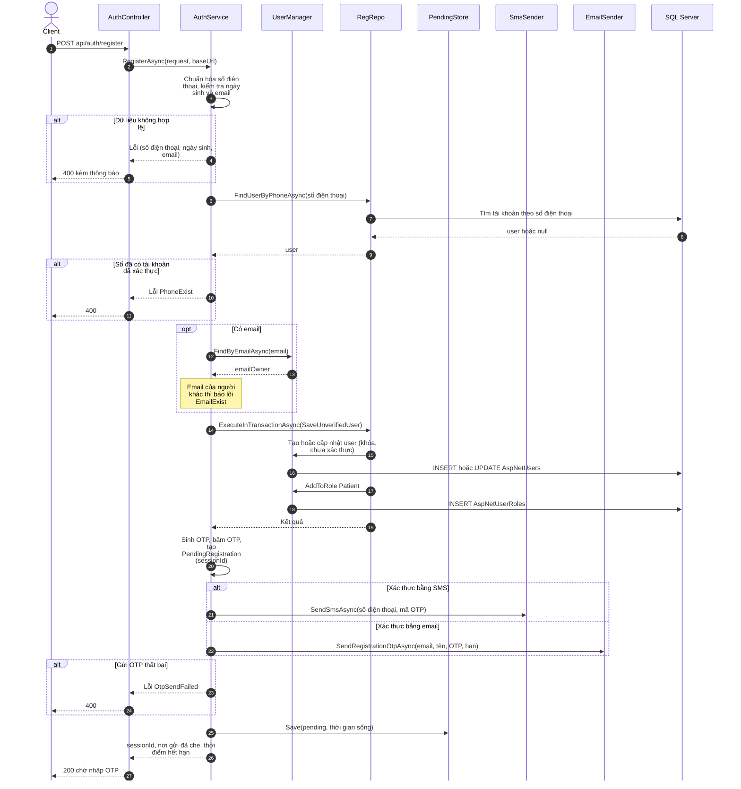
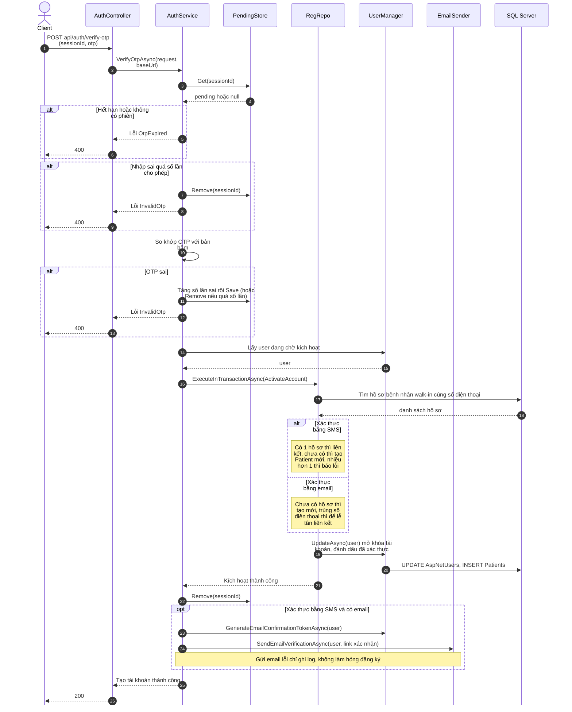
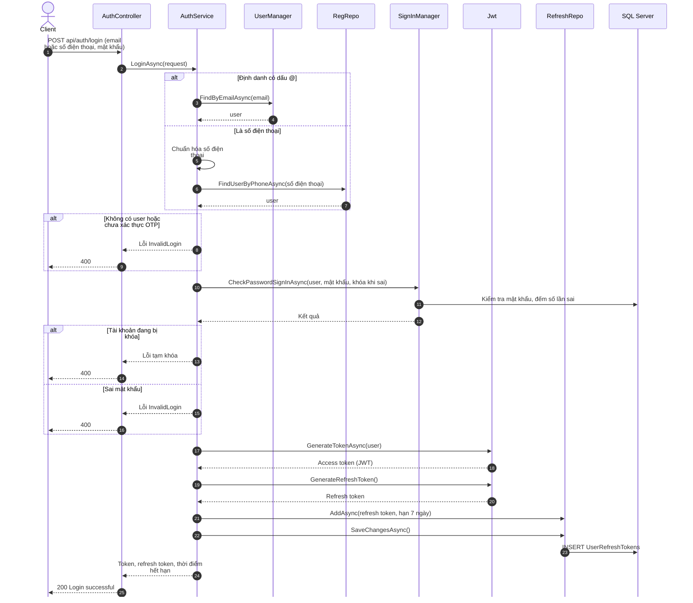
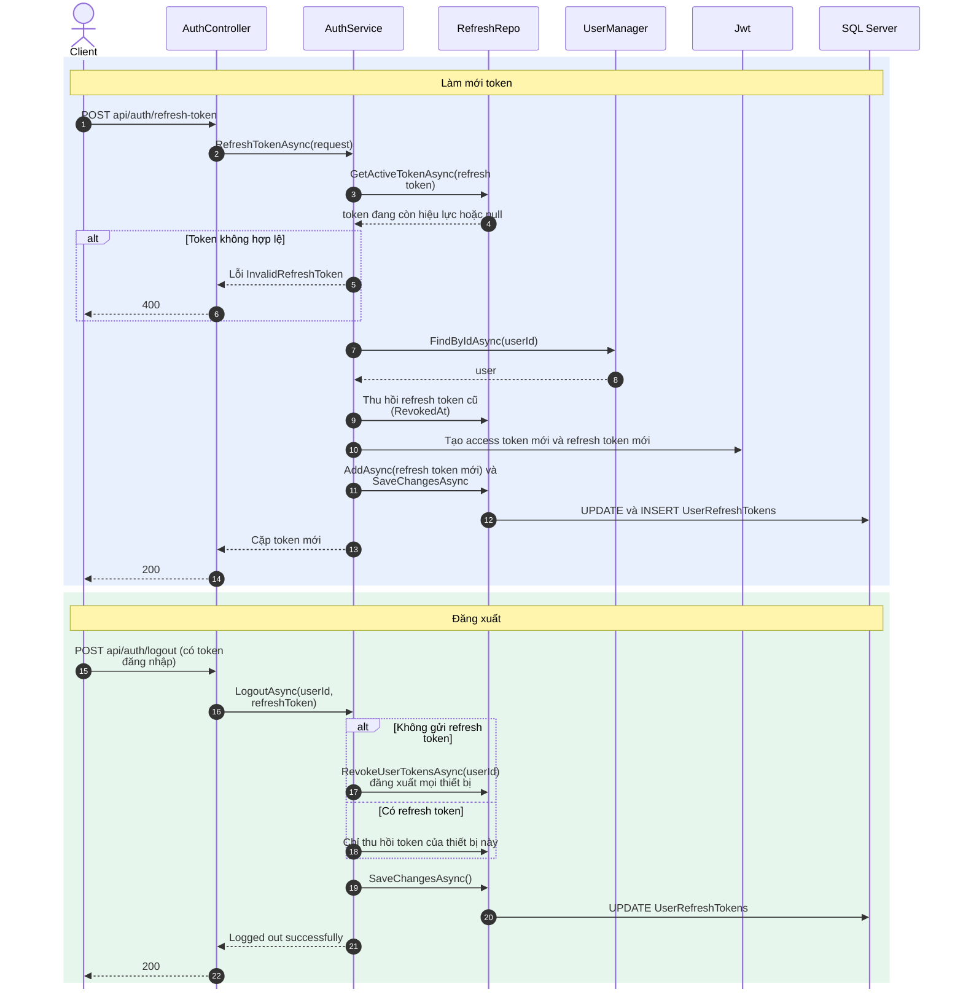
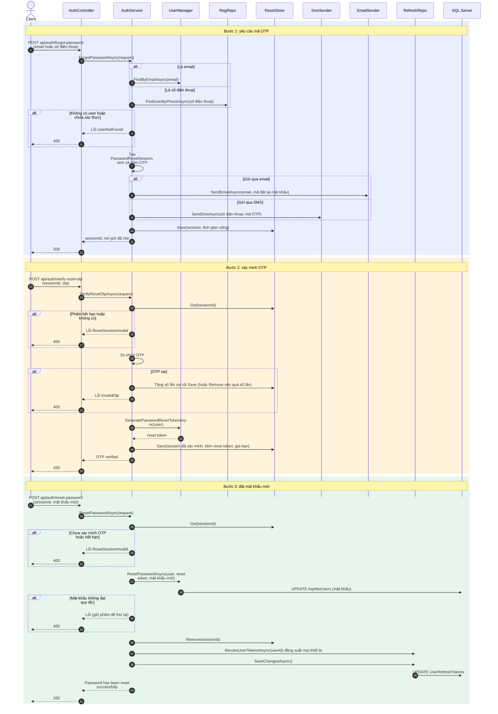

# Sequence diagram: AuthService (Mermaid)

Các sơ đồ tuần tự dưới đây lấy từ code thật trong `OZE.Application/Services/AuthService.cs` và `OZE/Controllers/AuthController.cs`. Cùng cách xem với class diagram (xem phần cuối file).

Các thành phần dùng chung trong mọi sơ đồ:

| Ký hiệu | Là gì |
|---|---|
| Client | Trình duyệt (React) gọi API |
| Controller | `AuthController` |
| Service | `AuthService` |
| UserManager, SignInManager | ASP.NET Identity |
| RegRepo | `IRegistrationRepository` |
| RefreshRepo | `IUserRefreshTokenRepository` |
| PendingStore | `IPendingRegistrationStore` (OTP đăng ký, lưu trong bộ nhớ) |
| ResetStore | `IPasswordResetStore` (OTP quên mật khẩu, lưu trong bộ nhớ) |
| Jwt | `IJwtTokenGenerator` |
| Sms, Email | `ISmsSender` (Twilio), `IEmailSender` (SendGrid) |
| DB | SQL Server |

## 1. Đăng ký tài khoản (Register)



## 2. Xác thực OTP đăng ký (VerifyOtp)



## 3. Đăng nhập (Login)



## 4. Làm mới token và đăng xuất (RefreshToken, Logout)



## 5. Quên mật khẩu (3 bước: Forgot, VerifyResetOtp, ResetPassword)



## Config cho mermaid.live (tab Config)

Công cụ có sẵn tab **Config** (mặc định là `{"theme": "redux-color"}`, theme này tô màu và vẽ kiểu tay nên hình trông lạ). Xóa nội dung cũ trong tab Config và dán đoạn này vào:

```json
{
  "theme": "default",
  "look": "classic",
  "sequence": {
    "wrap": true,
    "width": 150,
    "actorMargin": 40,
    "messageMargin": 30,
    "mirrorActors": false
  }
}
```

Muốn giữ màu cho các ô nhân vật như hình bạn đã thấy nhưng vẫn nét thẳng, chỉ đổi dòng đầu thành `"theme": "redux-color"` và giữ `"look": "classic"`.

Dòng `%%{init: ...}%%` ở đầu mỗi sơ đồ làm cùng việc này, dùng cho nơi không có tab Config (VS Code, GitHub). Dùng một trong hai là đủ, nếu dùng cả hai thì dòng trong code được ưu tiên.

## Cách xem và xuất ảnh

**VS Code:** cài tiện ích **Markdown Preview Mermaid Support**, mở file này rồi bấm `Ctrl+Shift+V`.

**Web:** vào https://mermaid.live, dán code của **một** sơ đồ (phần giữa hai dòng ` ```mermaid ` và ` ``` `) vào ô bên trái, bấm **Actions** rồi chọn PNG hoặc SVG.

**GitHub** tự vẽ khi mở file `.md` này.

## Ghi chú

- Sơ đồ chỉ vẽ luồng chính và các nhánh lỗi quan trọng, không vẽ từng lỗi nhỏ để hình đọc được.
- OTP và phiên đăng ký, đặt lại mật khẩu lưu trong **bộ nhớ** (`PendingStore`, `ResetStore`), nên không có bước ghi DB cho phần này. Khi triển khai Redis, hai thành phần này sẽ đổi sang Redis mà luồng không đổi.
- Các luồng còn lại (đổi mật khẩu, xác nhận email, gửi lại OTP) có cấu trúc tương tự, nếu cần tôi vẽ thêm.
